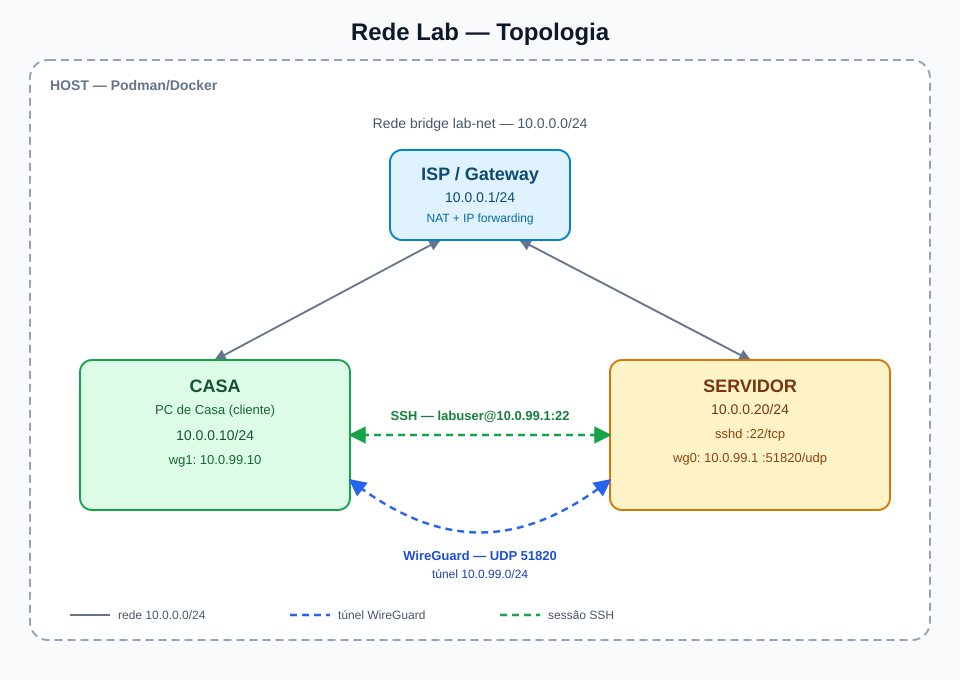
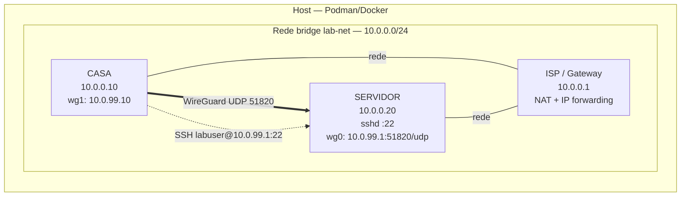

# Topologia de Rede

## Diagrama visual



Versões alternativas:

- [`topologia.svg`](topologia.svg) — imagem vetorial
- [`topologia.mmd`](topologia.mmd) — fonte Mermaid

## Diagrama ASCII

```
┌─────────────────────────────────────────────────────────────────────┐
│                    HOST — Podman / Docker                            │
│                                                                     │
│                  rede bridge lab-net: 10.0.0.0/24                   │
│                                                                     │
│        ┌────────────────────┐                                       │
│        │        ISP         │                                       │
│        │      10.0.0.1      │                                       │
│        │  NAT + forwarding  │                                       │
│        └───────┬────────────┘                                       │
│                │                                                    │
│       ┌────────┴─────────┐                                          │
│       │                  │                                          │
│  ┌────▼─────┐      ┌─────▼──────┐                                  │
│  │   CASA   │      │  SERVIDOR  │                                  │
│  │ 10.0.0.10│      │  10.0.0.20 │                                  │
│  │wg1 .99.10│      │wg0 .99.1   │                                  │
│  └────┬─────┘      └─────┬──────┘                                  │
│       │                  │                                          │
│       └──── WireGuard UDP 51820 ────┘                              │
│             túnel 10.0.99.0/24  (SSH :22 dentro do túnel)          │
└─────────────────────────────────────────────────────────────────────┘
```

## Diagrama Mermaid



## Componentes

### ISP / Gateway (container `isp`)
- Função: gateway, NAT (MASQUERADE) e IP forwarding.
- Endereço: `10.0.0.1/24` (rede bridge `lab-net`).
- A bridge usa `10.0.0.254` como IP reservado de gateway; o gateway
  lógico da rede é o ISP em `10.0.0.1`.
- Encaminha o tráfego entre `casa` e `servidor`.
- Em Podman rootless, o `iptables` pode não carregar módulos do kernel;
  nesse caso o NAT é apenas conceitual e a comunicação direta pela bridge
  continua funcionando.

### PC de Casa (container `casa`)
- Função: cliente final.
- Endereço na bridge: `10.0.0.10/24` (gateway `10.0.0.1`).
- Cliente WireGuard (`wg1`): `10.0.99.10/24`.
- Cliente SSH: conecta ao servidor via túnel em `10.0.99.1:22`.

### Servidor (container `servidor`)
- Função: servidor de serviços.
- Endereço na bridge: `10.0.0.20/24` (gateway `10.0.0.1`).
- Servidor WireGuard (`wg0`): `10.0.99.1/24`, escuta em `51820/udp`.
- Servidor SSH: `0.0.0.0:22` (acessível pelo túnel em `10.0.99.1`).

## Planos de endereçamento

| Plano | Faixa | Uso |
|-------|-------|-----|
| Bridge / WAN simulada | `10.0.0.0/24` | Comunicação dos containers |
| Túnel WireGuard | `10.0.99.0/24` | VPN entre casa e servidor |

| Host | Bridge (`10.0.0.0/24`) | WireGuard (`10.0.99.0/24`) |
|------|-------------------------|----------------------------|
| ISP | `10.0.0.1` (gateway) | — |
| Casa | `10.0.0.10` | `10.0.99.10` |
| Servidor | `10.0.0.20` | `10.0.99.1` |

## Fluxo de tráfego

1. A casa gera um pacote SSH com destino `10.0.99.1` (IP do servidor no túnel).
2. O WireGuard encapsula o pacote em UDP e envia para `10.0.0.20:51820`.
3. O ISP atua como gateway/NAT da rede `10.0.0.0/24`.
4. O servidor decapsula o WireGuard e entrega o SSH à porta 22.
5. A resposta percorre o caminho inverso até a casa.

## Portas

| Serviço | Container | Porta | Protocolo | Observação |
|---------|-----------|-------|-----------|------------|
| SSH | servidor | 22 | TCP | Acessível via `10.0.99.1` |
| WireGuard | servidor | 51820 | UDP | Porta fixa do túnel |
| WireGuard | casa | efêmera | UDP | Escolhida pelo kernel |

## Como regenerar/editar o diagrama

- **SVG**: edite `docs/topologia.svg` diretamente (texto puro).
- **Mermaid**: edite `docs/topologia.mmd` ou o bloco Mermaid acima.
- **ASCII**: edite o bloco correspondente neste arquivo.
